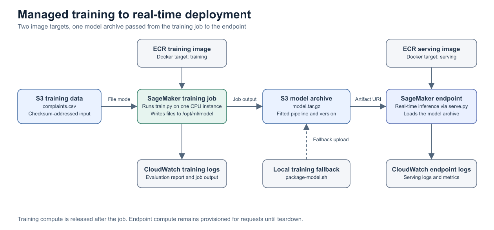

# SageMaker AI Signal → Insight → Action Workshop

Train a TF-IDF and logistic regression classifier on synthetic complaint data, run the same training code in SageMaker AI, and deploy the resulting model to a real-time endpoint. The workshop is the SageMaker companion to the [Bedrock Signal → Insight → Action workshop](https://github.com/Emojot-Inc/ai-signal-insight-action-workshop).

| Lab | What you do | What to verify |
|---|---|---|
| **1. Local training and serving** | Fit the pipeline, package the model, and run it over HTTP. | Inspect the evaluation report. Send a complaint and change the routing threshold. |
| **2. Managed SageMaker training** | Run a CPU training job using a CSV in S3 and a training image in ECR. | Find the job status, evaluation logs, and model archive URI. |
| **3. Real-time deployment** | Deploy the archive produced by the training job with the separate serving image. | Match the endpoint's model URI to the job output. Invoke the endpoint and check `modelVersion`. |



[Architecture and editable diagrams](docs/architecture/README.md) · [Managed training lab](docs/cloud-training.md) · [Deployment playbook](docs/deployment-demo-playbook.md)

## Run the local lab

Use Python 3.13. The dataset has 64 synthetic complaints across four categories. The reported metrics describe this small test split, and the classifier scores are uncalibrated.

```bash
uv venv --python 3.13
source .venv/bin/activate
uv pip install -r requirements.txt
bash scripts/package-model.sh phase1-local-v1
python src/predict.py "The app freezes whenever I open my account"
python src/serve.py serve --bind 127.0.0.1 --model-dir artifacts
```

In another terminal, send the billing complaint and apply two routing thresholds:

```bash
source .venv/bin/activate
curl -fsS http://127.0.0.1:8080/ping
curl --fail-with-body -sS -H 'Content-Type: application/json' \
  --data-binary @events/complaint.json http://127.0.0.1:8080/invocations \
  -o artifacts/insight.json
python src/action.py artifacts/insight.json --minimum-score 0.35
python src/action.py artifacts/insight.json --minimum-score 0.60
```

The **signal** is the complaint JSON. The **insight** contains the category, score, and model version. The **action** CLI uses the score to simulate routing to a category queue or human review.

## Train and deploy on AWS

Complete the [sandbox preflight](docs/deployment-demo-playbook.md) first, including separate training and real-time endpoint quotas. Then start one shared job and endpoint:

```bash
bash scripts/deploy.sh phase1-cloud-v1 --cloud-train
```

The script publishes two images to ECR, starts managed training, and deploys the exact S3 archive returned by the completed job. Follow the [artifact handoff checks](docs/cloud-training.md#inspect-the-handoff) and the [participant invocation lab](docs/participant-guide.md). If managed training is unavailable, the [deployment playbook](docs/deployment-demo-playbook.md#rehearse-with-local-training) also gives the local-artifact deployment path.

- [Instructor guide](docs/instructor-guide.md) for sequencing, checkpoints, and fallback.
- [Architecture](docs/architecture/README.md) for images, storage, roles, and the request path.
- [MLOps design](docs/mlops.md) for evaluation gates, versioning, rollout, and monitoring.
- [Troubleshooting](docs/troubleshooting.md) and [cost and cleanup](docs/costing.md) for operating the lab.
