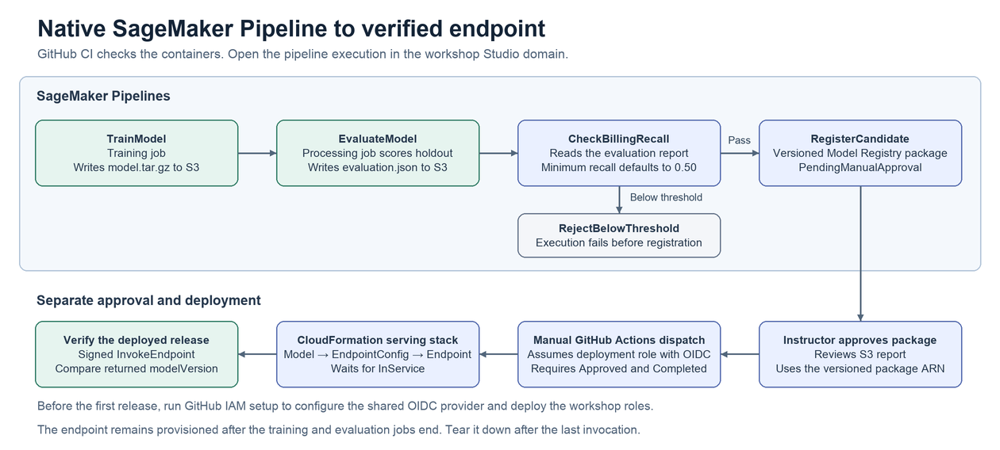
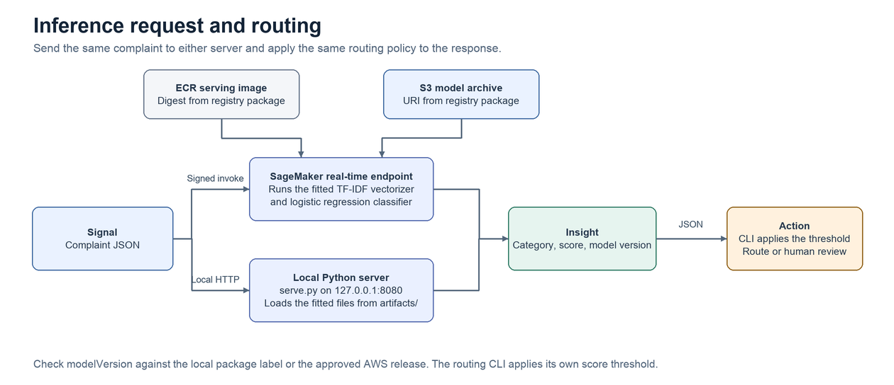
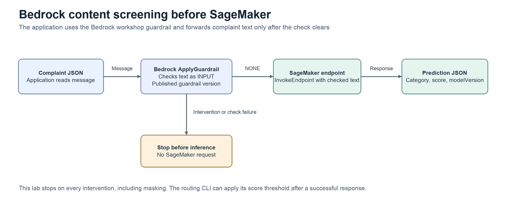
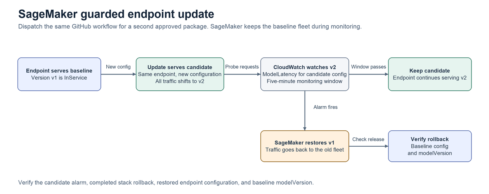

# Workshop architecture

## From training to a verified release

[Editable Draw.io source](serving.drawio) · [Open the overview PNG](training-to-endpoint.png)

| Stage | Handoff |
|---|---|
| **Build and launch** | GitHub CI checks the training, evaluation, and serving contracts on the runner. The instructor's AWS launcher provisions the Studio workspace and publishes the checksum-addressed CSV, pipeline definition, and two Linux AMD64 Docker image targets. The pipeline and package use image digests. |
| **Train** | `TrainModel` fits the classifier and writes the versioned `model.tar.gz` to S3. |
| **Evaluate and gate** | `EvaluateModel` reads that archive and scores the held-out rows. `CheckBillingRecall` reads the Processing job's `evaluation.json`. A pass registers a package. A miss fails the execution before registration. |
| **Register and approve** | The versioned Registry package starts as `PendingManualApproval` and references the exact archive, serving image, and report. The instructor reviews the report and approves the package. |
| **Promote and verify** | The manually dispatched GitHub workflow requires a package that is `Approved` and `Completed`. CloudFormation applies the Model, EndpointConfig, and Endpoint. A signed invocation checks the returned `modelVersion`. |

The [pipeline lab](../deployment-demo-playbook.md#inspect-the-run-in-studio) walks through the execution graph. The [registry and CI/CD lab](../model-registry-ci-cd.md) picks up at the versioned package ARN. Training and Processing release their compute when each job ends. The real-time endpoint remains provisioned until teardown. [AWS pipeline step data](https://docs.aws.amazon.com/sagemaker/latest/dg/build-and-manage-propertyfile.html) · [AWS model approval](https://docs.aws.amazon.com/sagemaker/latest/dg/model-registry-approve.html)

## Inference request

[Open the request flow PNG](inference-request.png)

In the [local lab](../../README.md#run-the-local-lab), `curl` calls `POST /invocations` on the local Python server, which loads the fitted files from `artifacts/`. For the AWS release, the caller signs an `InvokeEndpoint` request. SageMaker forwards it to `POST /invocations` on port `8080`. The serving container loads the fitted vectorizer and classifier from `/opt/ml/model`. The prediction includes the category, score, and release version. The local action CLI uses that response to simulate routing or human review. [Inference contract](../../specs/02-inference-contract.md) · [AWS InvokeEndpoint API](https://docs.aws.amazon.com/sagemaker/latest/APIReference/API_runtime_InvokeEndpoint.html)

## Content screening before inference

The [screening lab](../guardrails.md) uses the separately deployed Bedrock workshop guardrail. The caller proceeds to SageMaker on `NONE` and stops on an intervention or failed check.

## Blue/green rollout and rollback

The [rollback drill](../model-registry-ci-cd.md#demonstrate-rollback) uses a second approved package on the same endpoint. SageMaker shifts all traffic to the candidate and keeps the baseline fleet available during monitoring. A candidate latency alarm returns traffic to the baseline. The workflow verifies the alarm and the restored configuration and model version.

## Stack ownership and identities

| Where | What it owns or can do |
|---|---|
| [Assets stack](../../bootstrap.yaml) | S3 artifact bucket, immutable-tag ECR repository, and job role for training and evaluation. |
| [Pipeline stack](../../pipeline.yaml) | SageMaker Pipeline and orchestration role. The role starts and inspects training and Processing jobs, passes the job role, reads step outputs, and registers model packages. |
| [Studio stack](../../studio.yaml) | Dedicated inspection domain, instructor profile, execution role, VPC, and subnets. The instructor can open the pipeline graph, read evaluation reports from the workshop assets bucket, and approve versions in the workshop Registry group. |
| [Registry stack](../../registry.yaml) | Workshop Model Package Group. Pipeline executions create individual package versions. |
| [Account IAM](../model-registry-ci-cd.md#set-up-aws-access-once) | The setup script creates or reuses the shared GitHub OIDC provider with audience `sts.amazonaws.com`. The provider's lifecycle is independent of the workshop stacks. |
| [GitHub deployment IAM stack](../../github-deploy-iam.yaml) | Trusts the exact GitHub repository subject on `main` through the account OIDC provider. Creates the GitHub deployment role and the execution role it can pass to SageMaker. |
| [Serving stack](../../template.yaml) | Model, EndpointConfig, Endpoint, log group, and the candidate alarm during the drill. GitHub supplies the pre-provisioned SageMaker execution role. An instructor can supply a different role or use the stack-managed role when deploying directly. |
| Instructor and GitHub identities | The instructor launches the pipeline and reviews and approves packages. The GitHub deployment role reads packages and promotes approved releases. |
| Participant identity | Invokes the shared endpoint. The instructor can display execution details for participants with invoke-only access. |

[Deployment playbook](../deployment-demo-playbook.md) · [Cost and cleanup](../costing.md) · [Production MLOps](../mlops.md)
