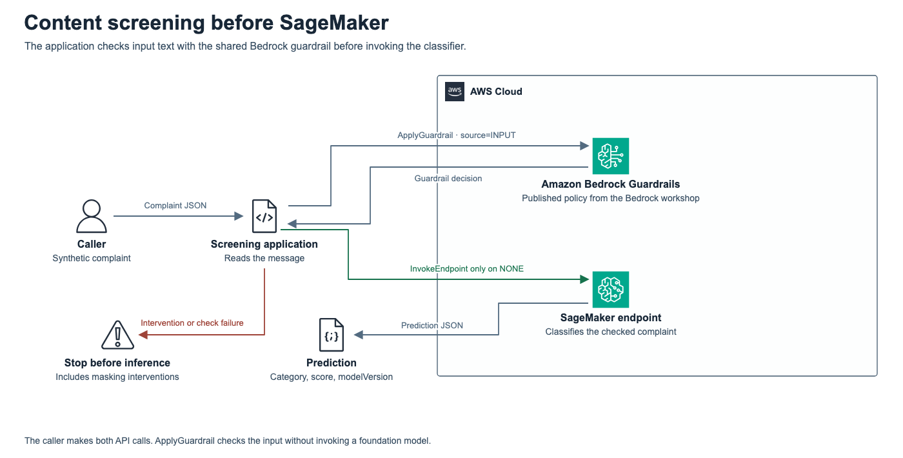

# Screen a complaint before SageMaker inference

Use the baseline SageMaker endpoint and the numbered guardrail version from the separately deployed [Bedrock workshop](https://github.com/rav94/ai-signal-insight-action-workshop). SageMaker's [deployment guardrails](architecture/README.md#bluegreen-rollout-and-rollback) protect endpoint updates. This exercise uses Bedrock Guardrails to check incoming content before calling the classifier.



## Reference the Bedrock guardrail

Deploy the Bedrock stack in live mode with `UseMockBedrock=false` so it publishes `BedrockGuardrailId` and `BedrockGuardrailVersion`. Use your teaching AWS profile. It needs `bedrock:ApplyGuardrail` on the published guardrail and `sagemaker:InvokeEndpoint` on the workshop endpoint. Retrieving the outputs also requires `cloudformation:DescribeStacks` on the Bedrock stack. The Bedrock stack owns the guardrail's lifecycle.

From the SageMaker repo root, use the AWS profile and SageMaker Region from [preflight](deployment-demo-playbook.md#preflight). Use your actual Bedrock stack name and Region if they differ.

```bash
bedrock_stack=ai-signal-insight-action-workshop
export BEDROCK_GUARDRAIL_REGION="${BEDROCK_GUARDRAIL_REGION:-$AWS_REGION}"

BEDROCK_GUARDRAIL_ID=$(aws cloudformation describe-stacks --stack-name "$bedrock_stack" \
  --region "$BEDROCK_GUARDRAIL_REGION" \
  --query "Stacks[0].Outputs[?OutputKey=='BedrockGuardrailId'].OutputValue | [0]" \
  --output text --no-cli-pager) &&
BEDROCK_GUARDRAIL_VERSION=$(aws cloudformation describe-stacks --stack-name "$bedrock_stack" \
  --region "$BEDROCK_GUARDRAIL_REGION" \
  --query "Stacks[0].Outputs[?OutputKey=='BedrockGuardrailVersion'].OutputValue | [0]" \
  --output text --no-cli-pager) &&
export BEDROCK_GUARDRAIL_ID BEDROCK_GUARDRAIL_VERSION
```

You can also export the two values from the Bedrock stack's **Outputs** tab. Keep `AWS_REGION` set to the SageMaker Region. `BEDROCK_GUARDRAIL_REGION` controls only the Bedrock call.

## Compare two requests

```bash
uv run --python 3.13 scripts/invoke-with-guardrail.py events/complaint.json
uv run --python 3.13 scripts/invoke-with-guardrail.py events/complaint-sensitive.json
```

The caller uses the default workshop endpoint, `WORKSHOP_STACK` if set, or the name supplied with `--endpoint`.

| Fixture | Expected result |
|---|---|
| Ordinary billing complaint | Bedrock returns `NONE`. The caller sends the checked message to SageMaker and prints `category`, `score`, and `modelVersion`. Confirm the version matches the deployed release. |
| Complaint with a synthetic email | The shared policy anonymizes email addresses and Bedrock returns `GUARDRAIL_INTERVENED`. This caller stops on every intervention, including masking, and exits with status `3`. SageMaker receives no request. |

The Bedrock call assesses the text without invoking a foundation model. If the check fails, the caller also skips SageMaker. In production, give endpoint invoke permission to the application that enforces the check. The direct invocation in the participant lab remains available for the workshop's endpoint exercise. [Guardrail contract](../specs/06-guardrails.md) · [AWS standalone ApplyGuardrail guidance](https://docs.aws.amazon.com/bedrock/latest/userguide/guardrails-use-independent-api.html)
