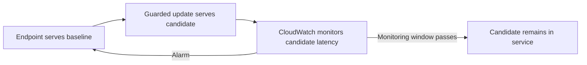
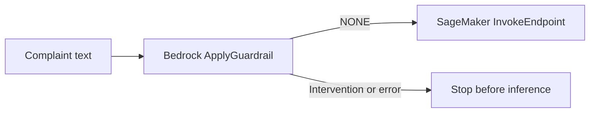

# Guardrails lab

Run this lab after the baseline SageMaker endpoint is `InService`. One exercise protects an **endpoint release**. The other checks **request content** before invoking the endpoint.



## 1. Protect a SageMaker endpoint update

Use the teaching profile, region, and account ID from the [deployment playbook](deployment-demo-playbook.md). Activate the Python environment and set `WORKSHOP_STACK` to the existing SageMaker serving stack. Confirm the region and account have enough hosting quota for the baseline and candidate fleets to overlap. The CloudFormation deployment role also needs permission to create and remove the CloudWatch metric alarm.

```bash
source .venv/bin/activate
export WORKSHOP_STACK=sagemaker-ai-signal-insight-action-workshop
aws sts get-caller-identity
```

Use the [participant lab](participant-guide.md) to record the baseline response's `modelVersion` and endpoint configuration before the update.

### Start a guarded update

In one terminal, update the existing endpoint using a fresh candidate version:

```bash
bash scripts/guarded-update.sh phase1-rollback-v2 1
```

The helper packages a fresh archive using the same training code, reuses the deployed serving image digest and instance type, and asks CloudFormation to update the endpoint. It keeps the baseline archive readable during the rollout.

The template creates a CloudWatch alarm for **the candidate endpoint configuration's** average `ModelLatency`. SageMaker shifts traffic to the candidate and monitors it for five minutes while retaining the old fleet. The threshold of **1 microsecond** is intentionally low so valid probe requests are expected to trip the alarm. This is a rollback drill. In a real rollout, set the threshold from the workload's latency objective and observed metrics. [AWS all-at-once deployment](https://docs.aws.amazon.com/sagemaker/latest/dg/deployment-guardrails-blue-green-all-at-once.html) · [AWS rollback alarm configuration](https://docs.aws.amazon.com/sagemaker/latest/dg/deployment-guardrails-configuration.html)

### Send traffic and verify rollback

In another terminal with the same AWS settings, start this bounded probe while the update is running. You can stop it with Ctrl+C once the rollback finishes. It samples `modelVersion` from successful responses.

```bash
mkdir -p artifacts
for attempt in {1..180}; do
  if aws sagemaker-runtime invoke-endpoint \
    --endpoint-name "$WORKSHOP_STACK" \
    --content-type application/json \
    --body fileb://events/complaint.json artifacts/rollout-probe.json >/dev/null; then
    python -c 'import json; print(json.load(open("artifacts/rollout-probe.json"))["modelVersion"])'
  fi
  sleep 5
done
```

Watch the alarm `<stack-name>-candidate-model-latency` in CloudWatch. Once it fires, inspect the alarm history, SageMaker, and CloudFormation:

```bash
aws cloudwatch describe-alarm-history \
  --alarm-name "$WORKSHOP_STACK-candidate-model-latency" \
  --history-item-type StateUpdate --max-items 10

aws sagemaker describe-endpoint --endpoint-name "$WORKSHOP_STACK" \
  --query '{Status:EndpointStatus,Config:EndpointConfigName,Failure:FailureReason}'

aws cloudformation describe-stack-events --stack-name "$WORKSHOP_STACK" \
  --query 'StackEvents[?LogicalResourceId==`Endpoint`].[Timestamp,ResourceStatus,ResourceStatusReason]' \
  --output table
```

**Pass condition:** the alarm records an intervention during the candidate's monitoring window. After rollback, the same endpoint is `InService` on the recorded baseline configuration and a fresh invocation returns the baseline `modelVersion`. CloudFormation can report a failed update when that rollback is expected. A failed update by itself is insufficient evidence that the alarm caused the rollback.

Start the update before the live teaching slot. If there are too few data points or provisioning runs long, use the alarm, stack events, and baseline response from a completed rehearsal.

## 2. Use Bedrock ApplyGuardrail in front of SageMaker



Use a **published** guardrail version from the existing Bedrock workshop stack. Retrieve its `BedrockGuardrailId` and `BedrockGuardrailVersion` outputs. The caller needs `bedrock:ApplyGuardrail` on the guardrail and `sagemaker:InvokeEndpoint` on the workshop endpoint. If the guardrail is in a different region, set `BEDROCK_GUARDRAIL_REGION` to that region and keep the SageMaker region in your usual AWS settings. Use the live Bedrock stack name and region for the following commands.

```bash
bedrock_stack=ai-signal-insight-action-workshop
export BEDROCK_GUARDRAIL_REGION=us-east-1

BEDROCK_GUARDRAIL_ID=$(aws cloudformation describe-stacks --stack-name "$bedrock_stack" \
  --region "$BEDROCK_GUARDRAIL_REGION" \
  --query "Stacks[0].Outputs[?OutputKey=='BedrockGuardrailId'].OutputValue | [0]" --output text)
BEDROCK_GUARDRAIL_VERSION=$(aws cloudformation describe-stacks --stack-name "$bedrock_stack" \
  --region "$BEDROCK_GUARDRAIL_REGION" \
  --query "Stacks[0].Outputs[?OutputKey=='BedrockGuardrailVersion'].OutputValue | [0]" --output text)
export BEDROCK_GUARDRAIL_ID BEDROCK_GUARDRAIL_VERSION
mkdir -p artifacts

python scripts/invoke-with-guardrail.py events/complaint.json \
  > artifacts/screened-insight.json &&
  python src/action.py artifacts/screened-insight.json --minimum-score 0.35
```

The helper sends the complaint text to `ApplyGuardrail` as `INPUT`. When the API returns `NONE`, it sends the same text to the SageMaker endpoint and prints the inference JSON. It stops before SageMaker on an intervention, API failure, or unexpected result. This lab's policy stops on all interventions, including when a guardrail supplies masked text.

Run the second case with a synthetic email address:

```bash
python scripts/invoke-with-guardrail.py events/complaint-sensitive.json
```

With the Bedrock workshop guardrail's email masking policy enabled, the expected result is a guardrail intervention, exit status `3`, and no SageMaker request. Rehearse that fixture with the published version you will use in class. For production enforcement, give endpoint invoke permission to the application role that performs the content check and route callers through that application.

[AWS ApplyGuardrail guide](https://docs.aws.amazon.com/bedrock/latest/userguide/guardrails-use-independent-api.html) · [Bedrock workshop policy](https://github.com/Emojot-Inc/ai-signal-insight-action-workshop/blob/6ad7944/template.yaml)

## Teaching checkpoint

Ask students to name the signal, owner, and response for each protection. The deployment policy reacts to candidate latency during rollout and restores the prior release. The application reacts to the content policy decision before it calls the endpoint. The routing threshold still governs what to do with a valid prediction.

Follow the [cost and cleanup guide](costing.md) after the final invocation. During a guarded rollout, budget for both serving fleets.
