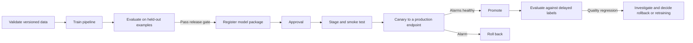

# Production release and operations design

Track the training data revision, artifact checksum, image digest, and evaluation report together. Set explicit per-category recall requirements and a review queue capacity before release. Validate contract compatibility in staging. For a production canary, use service error and latency alarms, and verify you can redeploy the previous artifact and image. Separately, track changes in input and score distributions and measure quality after labels arrive. Route quality alerts to the team that can change the model or review policy.

For the live lab, run managed training, deploy the resulting artifact, and inspect the training logs and endpoint CloudWatch metrics. Use the pipeline above as a tabletop exercise.

[Model Registry](https://docs.aws.amazon.com/sagemaker/latest/dg/model-registry.html) · [Deployment guardrails](https://docs.aws.amazon.com/sagemaker/latest/dg/deployment-guardrails.html) · [CloudWatch metrics](https://docs.aws.amazon.com/sagemaker/latest/dg/monitoring-cloudwatch.html)
