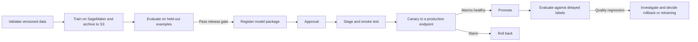

# Production release and operations design

Track the training data revision, training job ID, artifact URI or checksum, both image digests, and the evaluation report together. Set explicit per-category recall requirements and a review queue capacity before release. Validate contract compatibility in staging. For a production canary, use service error and latency alarms, and verify you can redeploy the previous artifact and image. Separately, track changes in input and score distributions and measure quality after labels arrive. Route quality alerts to the team that can change the model or review policy.

The main workshop runs a [native SageMaker Pipeline](sagemaker-pipeline.md) with a separate evaluation job and billing recall gate. A passing package still needs manual model approval before promotion. The [guardrails lab](guardrails.md) adds a blue/green update with a CloudWatch latency alarm and automatic rollback. The [Registry and CI/CD lab](model-registry-ci-cd.md) makes model registration, manual approval, and promotion of the exact artifact runnable. The production design above adds explicit quality gates and gradual traffic shifting. Use those steps as a tabletop exercise.

[Model Registry](https://docs.aws.amazon.com/sagemaker/latest/dg/model-registry.html) · [Deployment guardrails](https://docs.aws.amazon.com/sagemaker/latest/dg/deployment-guardrails.html) · [CloudWatch metrics](https://docs.aws.amazon.com/sagemaker/latest/dg/monitoring-cloudwatch.html)
