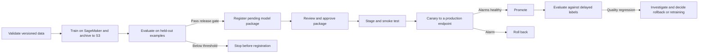

# Production release and operations design

The workshop exercises candidate building in SageMaker Pipelines, approval in Model Registry, and promotion with GitHub Actions. See the [workshop release diagram](architecture/README.md#from-training-to-a-verified-release) for the runnable architecture.

The [blue/green rollback drill](model-registry-ci-cd.md#demonstrate-rollback) uses an all-at-once shift and a deliberately sensitive alarm. The gradual rollout below is a production extension.

## Why separate model building and deployment?

The **model-building pipeline** trains, evaluates, and registers a versioned candidate. The **production deployment pipeline** promotes the approved package through the team's standard CI/CD process. Model Registry is the handoff between them.

The separation gives production its own permissions, checks, and rollout policy. An operator can deploy again or restore a previous approved version with the original artifact and container image. In this workshop, GitHub CI tests the container contract. The separate GitHub deployment workflow checks the package approval, provisions or updates the endpoint, and verifies the version serving live requests. [AWS deployment guidance](https://docs.aws.amazon.com/prescriptive-guidance/latest/ml-operations-planning/deployment.html) · [AWS example of separate build and deploy pipelines](https://docs.aws.amazon.com/prescriptive-guidance/latest/patterns/build-an-mlops-workflow-by-using-amazon-sagemaker-and-azure-devops.html)

## Production extensions

Track the training data revision, training job ID, artifact URI or checksum, both image digests, and the evaluation report together. Set explicit per-category recall requirements and a review queue capacity before release. Validate contract compatibility in staging. For a production canary, use service error and latency alarms, and verify you can redeploy the previous artifact and image. Separately, track changes in input and score distributions and measure quality after labels arrive. Route quality alerts to the team that can change the model or review policy.

[Model Registry](https://docs.aws.amazon.com/sagemaker/latest/dg/model-registry.html) · [Deployment guardrails](https://docs.aws.amazon.com/sagemaker/latest/dg/deployment-guardrails.html) · [CloudWatch metrics](https://docs.aws.amazon.com/sagemaker/latest/dg/monitoring-cloudwatch.html)
