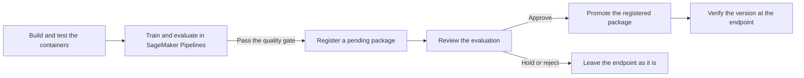

# Model Registry and CI/CD lab

This lab separates preparing a model from promoting it. GitHub Actions runs the container checks on pull requests and pushes to `main`. The deployment workflow runs on demand and accepts a specific approved SageMaker model package ARN.



## Start with a pipeline candidate

Run the [native pipeline lab](sagemaker-pipeline.md) first. Its passing branch creates a versioned package as `PendingManualApproval` and links the evaluation report. Use the ARN from the `RegisterCandidate` step.

For a registry-only fallback, activate the Python environment and run `bash scripts/deploy.sh phase1-registry-v1 --register-only` to train locally and prepare a package.

## Review and approve the package

Set `package_arn` to the full versioned ARN from the pipeline registration step:

```bash
package_arn='<versioned model package ARN>'
aws sagemaker describe-model-package --model-package-name "$package_arn" \
  --query '{Approval:ModelApprovalStatus,Status:ModelPackageStatus,Version:CustomerMetadataProperties.ReleaseVersion,Assets:InferenceSpecification.Containers}'

bash scripts/deploy-approved.sh "$package_arn"
```

Expect the deploy command to exit `3` while the package awaits approval. It stops before any serving stack changes. Wait until `ModelPackageStatus` reports `Completed` before continuing.

Review the container checks and the [evaluation report](sagemaker-pipeline.md#inspect-the-report-and-package) from the Processing step. For this sandbox exercise, approve after reviewing the report and confirming the serving contract. A production gate would require adequate independent test data and a meaningful target for billing recall. The workshop dataset's billing test split is too small for that release decision.

```bash
aws sagemaker update-model-package \
  --model-package-arn "$package_arn" \
  --model-approval-status Approved \
  --approval-description "Workshop sandbox evaluation reviewed"
```

Now run the **Deploy approved SageMaker release** workflow in GitHub Actions with `main` selected and paste the approved ARN. For a terminal-only rehearsal, use `bash scripts/deploy-approved.sh "$package_arn"`. Both routes use the same approval check and CloudFormation serving template, deploy the registered artifact and image, and fail the smoke test if the inference response's `modelVersion` differs from the registered release version.

One person can drive the AWS steps and another can verify the output. The useful classroom contrast is the pending version being stopped and the approved version reaching the endpoint. Keep the [guarded-update drill](guardrails.md) as a follow-on from the baseline.

## GitHub Actions setup

[Workshop CI](../.github/workflows/ci.yml) builds the training and serving images, trains and evaluates in local containers on the runner, and checks health, versioned inference, and malformed input. It runs with GitHub read access and requires Docker rather than AWS credentials. You can run the same check locally:

```bash
bash scripts/smoke-containers.sh
```

[Deploy approved SageMaker release](../.github/workflows/deploy-approved.yml) uses GitHub OIDC to obtain short-lived AWS credentials. Configure the following repository Actions variables:

| Variable | Value |
|---|---|
| `AWS_DEPLOY_ROLE_ARN` | IAM role for promotion in the teaching account |
| `AWS_REGION` | Region containing the package and workshop stacks |
| `WORKSHOP_ACCOUNT_ID` | Teaching AWS account ID |
| `WORKSHOP_STACK` | Optional. The serving stack name if it differs from the script default |

Create or reuse the IAM OIDC provider `token.actions.githubusercontent.com` with audience `sts.amazonaws.com`. Use this trust policy for the teaching role and replace the sample account ID. For a fork, substitute its exact owner and repo in the subject.

```json
{
  "Version": "2012-10-17",
  "Statement": [{
    "Effect": "Allow",
    "Principal": {
      "Federated": "arn:aws:iam::123456789012:oidc-provider/token.actions.githubusercontent.com"
    },
    "Action": "sts:AssumeRoleWithWebIdentity",
    "Condition": {
      "StringEquals": {
        "token.actions.githubusercontent.com:aud": "sts.amazonaws.com",
        "token.actions.githubusercontent.com:sub": "repo:rav94/sagemaker-ai-signal-to-action-workshop:ref:refs/heads/main"
      }
    }
  }]
}
```

The role needs permission to describe the workshop model package and its stacks, apply the serving CloudFormation changes, pass the serving execution role, describe the endpoint, and invoke it for the smoke test. Model approval stays with a separate instructor identity that can call `sagemaker:UpdateModelPackage`. [GitHub OIDC for AWS](https://docs.github.com/en/actions/how-tos/secure-your-work/security-harden-deployments/oidc-in-aws)

See [workshop cleanup](costing.md) for the registry stack and package versions.

[AWS Model Registry](https://docs.aws.amazon.com/sagemaker/latest/dg/model-registry.html) · [Model approval](https://docs.aws.amazon.com/sagemaker/latest/dg/model-registry-approve.html)
