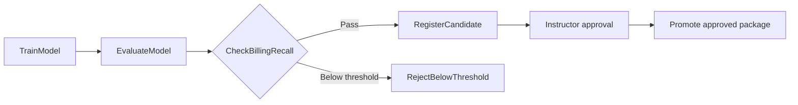

# Native SageMaker Pipeline lab

This is the main AWS demo. GitHub CI checks the two containers. SageMaker Pipelines produces and evaluates the candidate. Model Registry holds the approval. The existing deployment command or GitHub Actions promotes the approved package.



## Start an execution

Complete [preflight](deployment-demo-playbook.md#preflight). Use one shared AWS environment and a new release label for each build.

```bash
bash scripts/deploy.sh phase1-pipeline-v1 --pipeline
```

The launcher publishes the images and definitions to AWS, then prints the pipeline name and execution ARN. SageMaker runs the steps shown in Studio. The same command creates the support stacks on the first run. It does not create an endpoint.

| Step | Student checkpoint |
|---|---|
| `TrainModel` | Find the training job and its S3 `model.tar.gz` URI. |
| `EvaluateModel` | Verify that it consumes that artifact. Open `evaluation.json` and read accuracy, billing recall, and the number of billing examples. |
| `CheckBillingRecall` | Compare reported billing recall with the execution's `MinimumBillingRecall`. |
| `RegisterCandidate` or `RejectBelowThreshold` | A pass creates a `PendingManualApproval` package with the artifact and evaluation report. A failure ends this execution before registration. |

The evaluation job uses the same deterministic split as training and scores only the held-out rows. The data is synthetic. The default minimum billing recall of **0.50** is a sandbox threshold. Review the sample count and the report separately before discussing a production release threshold.

## Inspect the report and package

Use Studio's execution graph, or set `execution_arn` to the ARN from the launcher:

```bash
execution_arn='<PipelineExecutionArn>'
aws sagemaker list-pipeline-execution-steps --pipeline-execution-arn "$execution_arn" \
  --query 'PipelineExecutionSteps[].{Step:StepName,Status:StepStatus,Package:Metadata.RegisterModel.Arn}' \
  --output table
```

After `EvaluateModel` succeeds, get its report:

```bash
processing_arn=$(aws sagemaker list-pipeline-execution-steps \
  --pipeline-execution-arn "$execution_arn" \
  --query "PipelineExecutionSteps[?StepName=='EvaluateModel'].Metadata.ProcessingJob.Arn | [0]" \
  --output text)
report_prefix=$(aws sagemaker describe-processing-job --processing-job-name "${processing_arn##*/}" \
  --query "ProcessingOutputConfig.Outputs[?OutputName=='evaluation'].S3Output.S3Uri | [0]" \
  --output text)
aws s3 cp "${report_prefix%/}/evaluation.json" -
```

Take the versioned package ARN from `RegisterCandidate` into the [approval and promotion steps](model-registry-ci-cd.md#review-and-approve-the-package). The promotion exercises the same inference contract as the local lab.

## Optional failed-gate example

Pre-stage this execution rather than waiting for a second training job in class. Use the pipeline name printed by the launcher and raise the threshold to 0.75 for this comparison.

```bash
pipeline='<pipeline name printed by the launcher>'
aws sagemaker start-pipeline-execution --pipeline-name "$pipeline" \
  --pipeline-parameters Name=MinimumBillingRecall,Value=0.75 \
  --query PipelineExecutionArn --output text
```

With the checked-in data, the locally verified billing recall is 0.50. Expect the stricter execution to reach `RejectBelowThreshold`. Explain that this run demonstrates the effect of a stronger release criterion. A production team would choose and document its target before testing a candidate.

For the class, keep one completed execution and pending package ready. Use [cleanup](costing.md#delete-after-the-final-invocation) after the final endpoint invocation. [AWS pipeline walkthrough](https://docs.aws.amazon.com/sagemaker/latest/dg/define-pipeline.html) · [Evaluation property files](https://docs.aws.amazon.com/sagemaker/latest/dg/build-and-manage-propertyfile.html)
